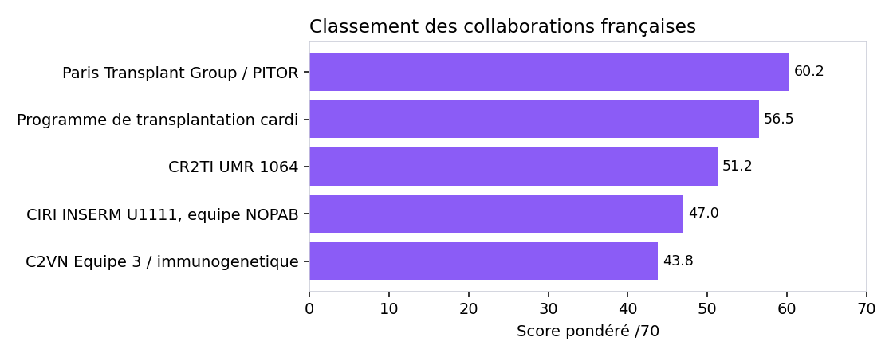
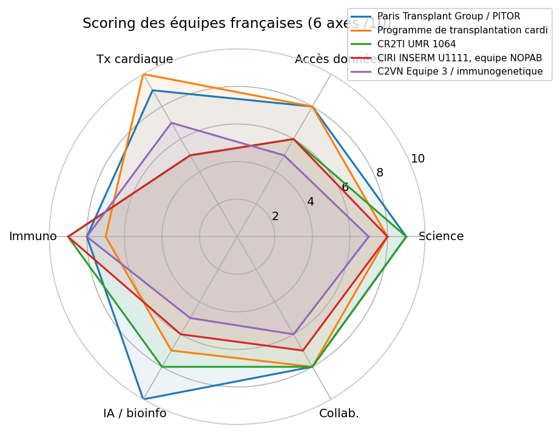

# Sections 15–17 — Proposition de collaboration, TOP 5, premier contact

*CardioTolerance-AI · v1 (2026-09-03). Scoring machine-lisible :
[`../data/french_teams_scoring.csv`](../data/french_teams_scoring.csv). Fiches :
[`section_07_french_landscape.md`](section_07_french_landscape.md).*

---

# Section 15 — Ce que chaque partie apporte

## Le chercheur bioinformatique / IA (MedFlow AI — Dr. M. L. Tall)
- Analyse **multi-omique** (transcriptome bulk & single-cell, TCR/BCR, intégration MOFA+).
- **Machine learning** : modèles pénalisés, ensembles d'arbres, modèles de survie,
  fusion multimodale ; **nested CV, calibration, validation externe, SHAP**.
- **Intégration et harmonisation** de données hétérogènes multi-sources ; correction de
  lot ; modèle de données commun.
- **Biomarker discovery** avec sélection de variables **stable**, anti-leakage.
- **Pipelines reproductibles** (Snakemake/Nextflow, conteneurs, versioning données/modèles).
- **Analyse statistique** et reporting normé (**TRIPOD+AI**, **PROBAST**, PRISMA).
- Recalcul homogène des scores immunogénétiques (**eplets HLA-EMMA, PIRCHE-II**).

## Le centre clinique / l'équipe académique
- **Cohorte** de transplantés cardiaques rétrospective (idéalement longitudinale).
- **Données cliniques** longitudinales et **suivi** (rejets, DSA, CAV, IS, survie).
- **Échantillons biologiques** et **biopsies** (histologie ISHLT ± moléculaire).
- **Données HLA / DSA** et expertise immunogénétique.
- **Expertise médicale** : définition clinique du phénotype, plausibilité, garde-fous.
- **Validation biologique** (cytométrie, qPCR, IHC, single-cell, essais fonctionnels).
- **Cadre réglementaire et éthique** (promoteur, CPP, CNIL/MR-004, conventions).

## Valeur de la collaboration — la boucle
`Données cliniques → IA / bioinformatique → biomarqueur candidat → validation biologique → validation clinique`
Chaque tour resserre la définition du phénotype et la signature ; aucune étape n'est
franchie sans relecture clinique.

---

# Section 16 — TOP 5 des collaborations françaises

Grille (chaque axe /10 ; total pondéré /70 ; poids : accès données ×1,5 ; expertise Tx
cardiaque ×1,25 ; potentiel collaboration ×1,25 ; sci., immuno., IA ×1,0).

| Rang | Équipe | Sci. | Accès données | Tx cardiaque | Immuno. | IA/bioinfo | Collab. | **Total /70** |
|---|---|---|---|---|---|---|---|---|
| 1 | **Paris Transplant Group / PITOR** (Loupy, Coutance, Duong Van Huyen) — PARCC | 9 | 8 | 9 | 8 | 10 | 8 | **60,25** |
| 2 | **Pitié-Salpêtrière — programme greffe cardiaque** (Coutance, Varnous) | 8 | 8 | 10 | 7 | 7 | 8 | **56,50** |
| 3 | **CR2TI Nantes** (Brouard, Danger) | 9 | 6 | 5 | 9 | 8 | 8 | **51,25** |
| 4 | **CIRI Lyon — NOPAB** (Thaunat) | 8 | 6 | 5 | 9 | 6 | 7 | **47,00** |
| 5 | **C2VN Équipe 3 / immunogénétique — AP-HM Marseille** (Pascale Paul) | 7 | 5 | 7 | 8 | 5 | 6 | **43,75** |

**Lecture** :
- Le **duo parisien** (1 & 2, en partie la même personne côté recherche : G. Coutance)
  domine sur *cœur + données + IA*.
- **Nantes** est n°3 malgré un accès cardiaque faible, parce que c'est l'équipe la plus
  alignée sur le **concept même de signature de tolérance** — précieuse en
  **co-encadrement méthodologique** même si elle n'apporte pas la cohorte cardiaque.
- **Marseille (C2VN Éq. 3, P. Paul)** : PI/unité confirmés ; angle NK CD16 / CAV
  original mais rôle attendu = **partenaire biologie/validation**, pas fournisseur de
  cohorte multi-omique longitudinale.

---

# Section 17 — « Si vous ne deviez en contacter qu'une, laquelle ? »

## Recommandation : **Paris Transplant Group / PITOR (PARCC), en visant l'angle cœur avec Guillaume Coutance, sous l'égide d'Alexandre Loupy.**

**Pourquoi eux :**
1. **Seule équipe française** réunissant déjà *cohortes cardiaques + transcriptome de
   biopsie + IA* opérationnels (MMDx-Heart, panel Banff HOT AMR cardiaque, heart HistoMX,
   essai NCT06436027).
2. G. Coutance fait le **pont** entre la recherche (PARCC) et le **plus gros programme de
   greffe cardiaque d'Europe** (Pitié) → un seul contact ouvre les deux.
3. Culture **explicite de l'IA en transplantation** (iBox) : ils parlent le même langage
   méthodologique (validation externe, calibration, TRIPOD).

**Le risque à gérer, et comment :**
- Ils sont **très forts en ML en interne** → ne pas se présenter comme « le ML ». Se
  présenter comme apportant **l'angle *tolérance / stabilité immunologique profonde***
  (qu'ils n'ont pas priorisé), la **méthodologie signature multi-omique** (inspirée des
  travaux de tolérance rénale de Nantes), et une **paire de bras** dédiée, reproductible,
  sur données publiques dès le départ (Scénario A) — donc **peu coûteuse** pour eux.
- Proposer d'emblée un **livrable Scénario A** (réanalyse harmonisée MMDx/GEO pour définir
  la classe « absence durable de signal moléculaire de rejet ») comme **preuve de
  sérieux** avant toute demande d'accès à leurs données.

**Plan de contact :**
1. **Email court** (Section 18/19) → Guillaume Coutance, en copie/mention d'Alexandre
   Loupy, via l'adresse institutionnelle PARCC (`parcc.inserm.fr/contact/`) ou le
   formulaire `paristransplantgroup.com`. Objet centré « signature de tolérance / IA ».
2. Joindre le **one-pager** ([`../outreach/one_pager.md`](../outreach/one_pager.md)).
3. Proposer un **échange de 20–30 min** ; venir avec le plan Scénario A prêt.
4. **En parallèle, contact « méthodologique » de Nantes (Brouard)** possible en n°2, sans
   concurrence : rôle de co-encadrement signature, pas d'accès données requis.
5. Relance à **J+10** si pas de réponse.

**Avant envoi : validation par Dr. Tall** (identité, périmètre de l'offre, cible
nominative).
